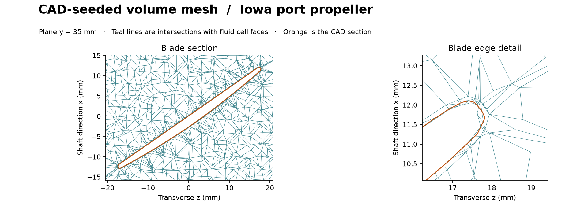
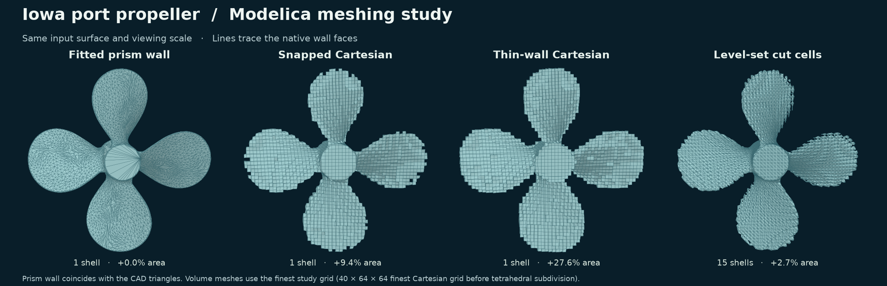

# Iowa port propeller mesh sensitivity

The best complete exterior mesh in this study uses CAD-seeded Delaunay tetrahedra and a Modelica signed-distance cut. The resulting 512,392 fluid cells have one connected propeller wall. Its area differs from the reference by −0.023% and its enclosed volume by −0.299%. It passes native signed-volume, closure and face-pyramid checks. The smallest cell is 1.18 × 10⁻¹⁷ m³. These geometry results do not qualify the mesh for a particular turbulence model or explicit timestep.



## Surface geometry and topology

The common input is the repaired, 12,000-triangle, shaft-aligned surface bundled by Ocean Web from the W2025 CAD. The reference area is 150.805 cm² and enclosed volume is 23.658 cm³. All complete meshes use the same outer tank bounds. Surface errors below use the triangulated reference. The finest Cartesian background uses 40 × 64 × 64 logical cells with 1.3 mm axial and 2.0 mm transverse spacing before far-field stretching. The adaptive Cartesian methods spend fewer cells away from the body. The regular level-set method splits each background box into six tetrahedra. [Workshop geometry revision](https://w2025.nl/news/update-of-onrt-shaft-geometry/)

| Method | Fluid cells | Wall shells | Area error | Enclosed volume error | 95th percentile wall → CAD distance |
| --- | ---: | ---: | ---: | ---: | ---: |
| CAD-seeded tetrahedral cut | 512,392 | 1 | −0.023% | −0.299% | 0.037 mm |
| Snapped Cartesian, fine | 112,298 | 1 | +9.40% | +2.22% | 0.625 mm |
| Thin-wall Cartesian, fine | 111,731 | 1 | +27.55% | +10.35% | 1.072 mm |
| Regular level-set cut, fine | 969,173 | 15 | +2.67% | −7.73% | 0.555 mm |
| Fitted prism block, three layers | 36,000 near-wall cells | 1 | 0% to rounding | 0% to rounding | Original facets |

Each nearest-surface test sampled 30,000 area-weighted positions in each direction on the inspection exports. For the CAD-seeded mesh the reverse 95th percentile was 0.036 mm and the largest sampled bidirectional discrepancy was 1.016 mm. This is a sampled maximum. The wall's Euler characteristic was 2, the same as the input. The fine snapped Cartesian mesh had one shell but Euler characteristic −10, indicating additional handles. The regular cut-cell mesh had tiny isolated components and a minimum cell volume of 2.58 × 10⁻²² m³. A visually smooth silhouette, a small total-area error, or positive cell volumes alone can miss these defects.



The CAD-seeded background adds samples on both sides of each CAD vertex and triangle centroid and grades the far-field spacing. SciPy/Qhull builds an unconstrained Delaunay background, VTK samples the signed distance, and native Modelica clips the tetrahedra and assembles oriented finite-volume faces. The final wall follows a piecewise-linear distance field. At sample offsets of 70, 140 and 280 μm the wall stayed in one piece in all three runs. The corresponding area errors were +0.028%, −0.023% and +0.457%. This varies one sampling parameter while preserving the source tessellation and far-field recipe.

The separate fitted prism option preserves every input wall triangle. Requested total thicknesses of 25, 50 and 100 μm all passed local cell checks with local thickness limiting. For the nominal 50 μm case, the achieved total ranged from 0.628 to 50 μm. This block still needs a compatible outer core. Attempting to insert three 25 μm-total uniform layers into the CAD-seeded core inverted a cell. The complete mesh and section pictured above omit that failed extrusion. For viscous propeller CFD, published examples use blade-fitted structured blocks and focus resolution in the tip vortex. That is a stronger comparison target for blade loading and wake transport. [Viitanen et al., propeller grid and flow study](https://acris.aalto.fi/ws/portalfiles/portal/27992297/ENG_Viitanen_DDES_of_Wetted_journal_of_Marine_Science_and_Engineering.pdf)

## Flow sensitivity

The GPU study uses the existing Modelica-derived D3Q19 blade-normal slip kernel on an RTX 3090, with 538 rpm, 0.1066 m diameter and a one-revolution startup ramp. Native finite-volume cells and the uniform GPU lattice are different discretizations. To isolate surface representation, each candidate wall was **rasterized back to the same lattice** with the same fractional-occupancy and nearest-normal procedure. Separate runs vary lattice resolution and time step. OpenModelica executed the meshing examples. The reported hydrodynamics are offline Rumoca-kernel results.

| Wall input at J = 0.8, 16 lattice cells/D, 671 steps/turn | Mean Kₜ | Mean Kq | Efficiency | Repeated within tolerance? |
| --- | ---: | ---: | ---: | --- |
| IIHR measurement | 0.3508 | 0.0909 | 0.4912 | Experimental reference |
| Reference CAD | 0.2868 | 0.1289 | 0.2833 | Yes, 12 periods |
| CAD-seeded mesh wall | 0.2836 | 0.1302 | 0.2774 | Yes, 12 periods |

Replacing the CAD with the fitted cut wall changed mean thrust by −1.1% and torque by +1.0% at fixed solver settings. The fitted result still underpredicts IIHR thrust by about 19% and overpredicts torque by about 43%. Surface reconstruction alone explains little of that discrepancy at this operating point. Each of the three regular-grid **medium** walls failed the repeatability test at 32 periods and gave negative last-period thrust. Those runs identify failures of the wall/rasterization/solver combination. Their final values are diagnostics and cannot rank converged propeller efficiencies. [IIHR open-water data](https://simman2020.kr/contents/ONRT.php)

- **Spatial sensitivity.** With the usual lattice-scaled timestep, 12, 16 and 24 cells/D gave Kₜ = 0.1999, 0.2868 and 0.2734. This sequence is nonmonotone. At a common 1,006 steps per turn, the 16 and 24 cells/D runs settled at 0.2610 and 0.2734. The 12 cells/D case failed the repeatability criterion at that timestep.
- **Temporal sensitivity.** Holding the 16 cells/D grid fixed and doubling and quadrupling the usual steps per turn produced runs that did not settle within the 32-period cap. A temporal order of convergence or a grid-convergence index cannot be supported by these data.
- **Wake.** At two diameters downstream, the reference-CAD lattice runs at 12, 16 and 24 cells/D gave mean axial velocity 1.006, 1.104 and 1.090 m/s and mean signed swirl −0.447, −0.418 and −0.433 m/s. A historical steady OpenFOAM calculation gave 1.105 and −0.232 m/s. These are disk means over 12 equal-area annuli and 64 azimuths. The lattice values are final-phase samples. The OpenFOAM field uses an earlier geometry and a different wall treatment. No experimental wake-velocity field was used.

The repeatability test requires three successive turns with less than 2% change in both loads and the sampled near-wake velocity norm. All coefficients above use a full final-period mean. The raw data also include the common seventh period for comparisons at equal physical time. The flow study does not include a no-slip solve directly on the new finite-volume mesh, blade-wall pressure validation or a claim of grid independence.

## Reproduce and inspect

Run from the root of `modelica_models`. The `ocean_web` checkout supplies the same input surface and GPU benchmark scripts.

```sh
python ../ocean_web/scripts/benchmarks/onrt-propeller/unpack-surface.py \
  ../ocean_web/viewer/assets/onrt/geometry/cad.bin.gz port.stl
python tools/propeller_mesh_study.py port.stl study --walls
python tools/onrt_mesh_field.py port.stl field.mat --offset 0.00014
```

Simulate `Meshing.Examples.SampledTetStudy(surfacePath="port.stl", fieldPath="field.mat", cacheDirectory="mesh-cache")` at initialization. Its `artifactPath` is the complete reloadable mesh. Use `tools/plot_propeller_section.py ARTIFACT.mat port.stl section.png` to reproduce the section. The Python background generator uses NumPy, SciPy and VTK. The regression models are `Tests.MeshingTests` and `Tests.MeshingCacheTests`. The standalone geometry sweep accepts `--omc` and `--msl` for an explicit compiler and local standard library.

For the GPU sensitivity runs, generate a mask and normal tensors with `rotor-mask.py WALL.stl mask --normal-tensors normals --resolution 16`. Run `lattice-gpu.py FMU_DIRECTORY mask normals RUN_DIRECTORY --advance-ratio 0.8 --frames 1 --periods 32` using the benchmark's compiled PropellerFlow source bundle. Change `--steps-per-turn` to fix physical timestep across grids or `--time-refinement` on a fixed grid. `check-wake.py CASE_DIRECTORY RUN_DIRECTORY` reads the reference OpenFOAM field through VTK.

Download the [native grid and prism sweep](propeller-mesh-results.csv), [CAD-seeded offset study](propeller-mesh-seeded.csv), [GPU operating points and refinement results](propeller-mesh-flow.csv) and [wake probes](propeller-mesh-wake.csv).
